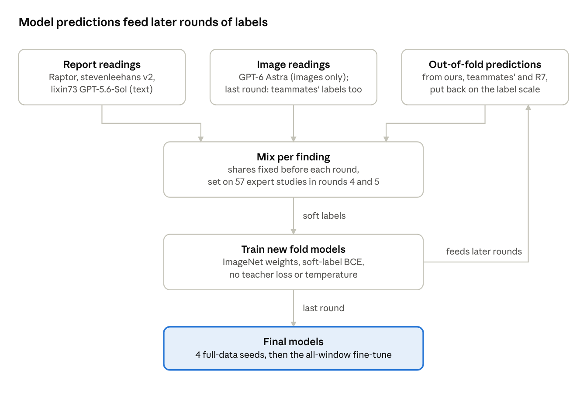

# RSNA Knee Abnormality Detection: Team MEJAL, 10th place (Max's part)

This branch holds Max's half of Team MEJAL's solution to the Kaggle competition
[RSNA Knee Abnormality Detection](https://www.kaggle.com/competitions/rsna-knee-abnormality-detection).
For each knee MRI study, the task is to score 12 findings: ACL tear, MCL tear, medial and lateral meniscus tear,
medial, lateral and patellofemoral (PF) osteoarthritis, effusion, synovitis, Baker's cyst, bone contusion and fracture.
The competition score is the ROC AUC averaged over the 12 findings. AUC is a number from 0.5 (random) to 1 (perfect)
that measures how well the scores put studies with a finding above studies without it.

| | Public leaderboard | Private leaderboard |
| --- | --- | --- |
| The team's best final pick (the teammates' notebook; it set the 10th place) | 0.967 | 0.957 |
| The team's other final pick: the team blend built with this code | 0.967 | 0.956 |
| Our four models alone, before the last fine-tune step | 0.964 | 0.953 |

Here "we" means Max and Claude (Anthropic's AI assistant), who built this part together. "The teammates" means the
other four members of Team MEJAL. They built the other half of the solution, the multi-backbone path (their own
labels and several model families), which carries half the weight of the team blend. Their code and labels are on the
[`codex/our-pipeline` branch](https://github.com/Evan2001ok/rsna-knee-abnormality-detection/tree/codex/our-pipeline)
of this repository.

- The team's write-up on Kaggle (both halves):
  [10th place solution](https://www.kaggle.com/competitions/rsna-knee-abnormality-detection/writeups/10th-place-solution)
- Our detailed write-up of this half: [docs/WRITEUP.md](docs/WRITEUP.md)
- Weights of our four final models: to be added. The competition's prize conditions ask winners to share their
  final models publicly, and we will do so as a public Kaggle dataset.
- Public Kaggle notebook of the final team blend: to be added.

## Words used in this README

| Word | Meaning here |
| --- | --- |
| Study | One knee MRI exam. It holds several **series** (image stacks), each a set of 2D **slices** in one plane (sagittal, coronal or axial). |
| Window | 3 neighbouring slices of one series, fed to the model like the 3 colour channels of a photo. |
| Label, soft label | The training target for one finding of one study. A soft label is a value between 0 and 1, not just yes or no. |
| Silent finding | A finding the study's report does not mention. |
| Report reading | A label read out of the study's radiology report by a language model. The test set has no reports. |
| Expert studies | The 58 training studies the host labelled with radiologists. Every team had to make its own labels for the other studies. |
| Unlabelled studies | 53 training studies whose reports name none of the 12 findings. |
| Fold, cross-validation | The other 4,296 studies are split into 4 or 5 groups (folds). Each model trains on all folds but one and is checked on the one it did not see. |
| Out-of-fold prediction | A model's prediction for a study it did not train on. Collected across folds, every study gets one. |
| Checking labels | Yes/no labels used only to score out-of-fold predictions, never for training (details under "Rebuild the training data"). |
| Round | One pass of "make labels, train models, mix their out-of-fold predictions into new labels". |
| Seed | The starting number for the random choices in training. Models with different seeds differ a little. |
| Leaderboard | Kaggle's ranking. The public leaderboard scores about 30% of the test set during the competition; the private leaderboard scores the rest and sets the final places. |
| R7 | A public model by Kaggle user heliosli (ConvNeXt-small, 4 folds), named after its weights dataset. |
| Raptor | dreaddevelopment's public notebooks and report labels. Our image preparation and model head adapt the notebooks. |
| OAI | The Osteoarthritis Initiative, an outside knee MRI study we used for extra training data. |

## The approach in short

- **Better labels in rounds.** We started from soft labels read out of the reports. Each round added a source:
  more report readings, OpenAI's GPT-6 Astra reading the images, and earlier models' out-of-fold predictions. Each new
  model trains from scratch on the new labels. This is a form of distillation (learning from earlier models), done
  only through the labels: no extra loss term and no older model running during training.
- **One model family.** A CoAtNet-2 image model (part convolution, part attention; 73M parameters) looks at windows
  from up to five series of a study. An attention head weighs all windows and gives 12 scores.
- **Final models.** Four seeds trained on all studies but 100, then fine-tuned for 4 more epochs on every window.
- **Team blend.** On Kaggle, our four models run next to the teammates' models and R7. The three groups are blended
  by rank: teammates 0.5, ours 0.3, R7 0.2.



*"Put back on the label scale" means mapped onto the range of the label values. In the last round, the teammates'
labels (their image-and-report readings mixed with report-only readings) joined the mix as well.*

Most of our gain came from the labels. Single-model leaderboard scores after each round:

| Round | What changed | Public | Private |
| --- | --- | --- | --- |
| 1 | ResNet34 models on report readings; three report readings averaged for five findings; silent findings half filled from earlier models' predictions | 0.924 | 0.915 |
| 2 | GPT-6 Astra image readings mixed in at one third | 0.943 | 0.932 |
| 3 | Out-of-fold predictions mixed into every label; first CoAtNet-2 | 0.952 | 0.941 |
| 4 | Per finding, the mix of report, GPT and model predictions set by how well each reads the expert studies ("source choice") | 0.957 | 0.945 |
| 5 | Same rule, model source retrained without earlier model predictions in its labels | 0.958 | 0.947 |
| 6 | 30% R7 predictions mixed in; 2,398 OAI knees added | 0.961 | 0.949 |
| 7 | Final labels (below); expert and unlabelled studies added to training; 4 folds | 0.963 | 0.952 |
| 8 | Same labels, four seeds trained on all data | 0.964 | 0.953 |

**Final labels** (called `consensus` in file names). Each label is the plain average of three sources: (1) our
round-5 labels; (2) the teammates' labels (0.7 × an AI reading of images and report + 0.3 × report-only readings;
now public as `labels/rsna/conv_labels_used.csv` on their branch); (3) all models' out-of-fold predictions, blended by
percentile rank per finding (teammates' nine model sets 0.45, ours 0.30, R7 0.25) and put back on the label scale.
The 58 expert studies keep the host's labels. Offline scores on these labels look better than they are, since some
sources had seen the checking studies, so the leaderboard decided label changes.

## The model and training

- **Input.** Five series slots per study: sagittal fluid-sensitive (32 slices), sagittal other (24), coronal
  fluid-sensitive (32), coronal other (24) and axial (32). Slices from the middle 6% to 94% of the stack, brightness
  scaled per series, a 140 mm square centre crop, stored at 336 px and enlarged to 384 px.
- **Backbone.** timm `coatnet_rmlp_2_rw_384.sw_in12k_ft_in1k`, starting from public ImageNet weights only.
- **Head.** Scores every window for every finding, then pools all windows of the study with a softmax (attention).

| Setting | Value |
| --- | --- |
| Loss | Binary cross-entropy on soft labels; blank labels skipped; a fixed extra weight on "present" per finding (1.2 to 7.7, in the config) because most findings are rare |
| Optimiser | AdamW; learning rate 3e-5 for the backbone and 1e-3 for the head; warm-up over the first 15%, then a slow decrease |
| Batch and length | 8 studies per update; 24 epochs (passes over the data); 12 random windows per study |
| Random image changes | Mirroring that keeps medial and lateral correct; rotation, zoom, shift; brightness and contrast; noise; blur |
| Series hiding | Each series hidden with 15% chance; each plane keeps at least one |
| Final weights | Average of the weights after epochs 22, 23 and 24 |
| All-window fine-tune | 4 more epochs, each step one whole study with every window; learning rates 1e-5 and 3e-4; layer statistics frozen; best 3 of 4 epochs on the 100 held-out studies averaged. +0.0021 out of fold, +0.0006 in the team blend |

## What is in this folder

| Path | What it holds |
| --- | --- |
| `src/rsna_knee_abnormality_detection/` | The Python package, run with the `knee` command: image preparation (`raptor_data.py`), model (`models.py`), training (`train.py`), random image changes (`augment.py`), scores (`metrics.py`), Kaggle export and prediction (`bundle.py`, `predict.py`) |
| `configs/final/` | Settings for the four final models: one base file and one fine-tune file per seed (42 to 45), with a short README |
| `configs/llm/gpt_image_labels_v1.md` | The exact instructions given to GPT-6 Astra for reading the images |
| `configs/backbones/` | An earlier-round example: the five CoAtNet-2 fold models trained on report-plus-GPT labels only (`srcchoice6`); their out-of-fold predictions were the model source of the round-5 labels |
| `configs/followup/`, `configs/teachers/` | Another earlier-round example: the round-1 ResNet34 "teacher" recipe (fold 0 in `followup/`, folds 1 to 4 in `teachers/`), read by `scripts/choose_teacher_recipe.py` and the tests |
| `configs/raptor_resnet34_silence_policy.yaml` | An early fold-0 test that filled seven findings' silent cells with hard zeros (it scored 0.0126 lower; see the write-up); a test reads it |
| `scripts/prepare_*.py`, `scripts/make_*.py`, `scripts/fetch_public_labels.py` | Image cache, labels for every round, checking labels, folds and the final training folder |
| `scripts/gpt_image_labels.py` | GPT image readings |
| `scripts/oai/` | OAI: choosing, downloading and laying out the series, image cache and labels |
| `scripts/build_team_combined_notebook.py`, `scripts/build_s6_blend_notebook.py`, `scripts/download_inference_wheels.py` | The team notebook builder, the builder of its base notebook (our stage plus R7's), and the offline install files our stage needs on Kaggle |
| Other `scripts/*.py` | The checking tools behind our decisions: out-of-fold scoring, blend-weight searches, the replay of the team blend and the R7 out-of-fold run. They read prediction files from our training runs, which are not included, so they mainly show how each number was measured |
| `tests/` | Automatic checks of the package and scripts; they run on a CPU |
| `docs/WRITEUP.md`, `docs/images/` | Our detailed write-up and its two charts |
| `third_party/` | `NOTICE` for the code adapted from the Raptor notebooks, and a copy of the Apache-2.0 licence |
| `LICENSE` | The licence of our code (CC BY-NC 4.0) |
| `pyproject.toml`, `uv.lock`, `.python-version` | Python package list with exact versions; Python 3.12 |
| `.gitignore` | Keeps data, training runs, work files under `artifacts/`, weights and the `.env` key file out of git |

File paths inside the scripts and configs are the local defaults we used (mostly under `data/`, `runs/` and
`artifacts/`), not files in this folder. Pass your own paths with the options listed by `--help`. A few inputs are
fixed near the top of a script instead; the script's opening lines say which.

### Names you will meet in file names and scripts

| Name | Meaning |
| --- | --- |
| `384`, `336` | Image size in pixels: models see 384 px; the image cache stores 336 px |
| `s42` to `s45` | Seeds 42 to 45 |
| `all` | Trained on all studies but 100 |
| `ftall`, `ft12` | The all-window fine-tune, and a control fine-tune that kept 12 windows |
| `w56` (and `w28`, ...) | Prediction with that many windows per study |
| `consensus`, `consensus58` | The final labels; `58` means the 58 expert studies are in training with the host's labels |
| `S1`, `S2`, `S3` | The three sources of the final labels: our round-5 labels, the teammates' labels, all models' out-of-fold predictions |
| `teacher`, `student` | Round 1: the teachers were five ResNet34 fold models on the Raptor labels; the students trained on labels that mix in the teachers' out-of-fold predictions |
| `avg_v2` | Round-1 report labels: three report readings averaged for the five findings without a severity threshold |
| `source_choice`, `srcchoice`, `v6`, `v7` | Source-choice labels (rounds 4 and 5). `v6` chooses only between the report and GPT readings; `v7`, our round-5 labels, adds the out-of-fold predictions of CoAtNet models trained on `v6` |
| `D`, `r7mix30` | The round-6 labels (0.7 × `v7` + 0.3 × R7's out-of-fold predictions) and the five fold models trained on them |
| `hybrid`, `oaihybrid`, `H` | OAI labels that average our labels from OAI's MOAKS grades (a standard MRI score of knee osteoarthritis) 50/50 with the teammates' OAI readings; `H` is the five fold models trained on `v7` with them |
| `oai_v00` | OAI knees from the first (baseline) visit |
| `theirs`, `ours`, `r7` | The three groups of the team blend: the teammates' models, our models, R7 |
| `judges` | The three label sets used to score out-of-fold predictions: severity-aware labels, agreement labels and the teammates' labels cut at 0.5 |
| `S6` (also `R6`) | Another public heliosli model of the same family as R7 |
| Fold numbers | In the split files, `0` to `3` (or `0` to `4`) are cross-validation folds; `-1` marks the 58 expert studies and `-2` the 53 unlabelled studies. In the final training folder, `5` marks rows that always train (OAI knees, expert and unlabelled studies) and `6` the 100 held-out studies |

## What is not included, and why

| Not included | Why | Where to get it |
| --- | --- | --- |
| Competition MRI images and tables | Competition data, not ours to share | The competition's data page |
| Our labels from every round, the GPT image readings, our checking labels and fold lists | One row per competition study, built from competition data; some hold the host's expert labels | Rebuild with the scripts below; exact values need inputs that are not public |
| Out-of-fold predictions and predictions on the expert studies | Same reason | Not available |
| OAI images and our OAI labels | OAI's terms: each user requests access | NIMH Data Archive (see below) |
| Model weights | Too large for git | Public Kaggle dataset, to be added |
| Image caches and training run folders (`data/`, `runs/`) | Made by the scripts; hundreds of GB | Run the scripts |
| Experiment records, working notes and logs | They hold study IDs, details of our computers and team discussions. A few scripts still write the name of such a record (`experiments/<name>.json`) into their output | The main numbers are in the write-up |
| The teammates' models, labels and inference code | Their work | Their branch, linked above |
| R7 code and weights | heliosli's work, not ours to share | heliosli's Kaggle pages (see Credits) |
| Keys and passwords | Never stored | See the GPT and OAI steps below |

## Setup

Python 3.12 and [uv](https://docs.astral.sh/uv/). From this folder:

```bash
uv sync --locked      # PyTorch 2.8 with CUDA 12.8, timm 1.0.26, DICOM decoders
uv run knee --help
uv run pytest -q      # CPU only, about 6 minutes
```

Put the competition download, unchanged, in `data/rsna-knee-abnormality-detection/`. We trained on
RTX 5090 cards (32 GB each) and checked things on an RTX 3090. Kaggle prediction ran on 2 × T4.

## Train the four final models

The final settings read one training folder, `data/combined/oai_v00_336_consensus58_4f/` (OAI first visit,
336 px cache, final labels with the 58 expert studies, 4 folds). It holds four files:

- `manifest.csv`: the image cache of every study and OAI knee (made by `scripts/prepare_raptor.py` and `scripts/oai/`);
- `labels.csv`: the final labels;
- `validation_labels.csv`: yes/no labels used to check the 100 held-out studies;
- `splits_all.csv`: which studies train. Fold 6 is the 100 held-out studies (the configs set `fold: 6`); fold 5
  (OAI knees, expert and unlabelled studies) always trains, and so do folds 0 to 3.

Then, once per seed (42 to 45):

```bash
uv run knee train --config configs/final/coatnet_384_consensus58_all_s42.yaml        # about 2.9 h on one RTX 5090
uv run knee train --config configs/final/coatnet_384_consensus58_all_ftall_s42.yaml  # about 6.5 h, up to 14 GB GPU memory
```

The fine-tune starts from the base run's `averaged-model.pt`. The seed files differ only in `seed` and `output_dir`
(and, in the fine-tune files, `init_checkpoint`, which points to the same seed's base run).
The final models were trained with an earlier copy of this code; this version has the same fine-tune options.

## Rebuild the training data

Each step's script explains its inputs in its opening lines, and most also list their options with `--help`.
`make_consensus_combined.py` and `oai/swap_oai_labels.py` take plain positional inputs, and `prepare_round3_labels.py`
needs `artifacts/teacher-recipe-decision.json` (written by `choose_teacher_recipe.py`) before even `--help` works.

1. **Image cache:** `scripts/prepare_raptor.py --variant raptor-dense-distinct-v1` (336 px; add `--split test` for test).
2. **Folds:** `scripts/fetch_public_labels.py` (downloads Pilkwang's public yes/no report labels), then
   `uv run knee labels --train-csv data/rsna-knee-abnormality-detection/train.csv --weak-csv <Pilkwang yes/no file>`
   and `uv run knee split --folds 4 --output-dir data/splits/four_fold` (balanced by finding, seed 42) for rounds 7
   and 8. Rounds 1 to 6 and `prepare_consensus_labels.py` use the default 5-fold split, `uv run knee split` (written to
   `data/splits/baseline`).
3. **Checking labels:** `scripts/prepare_severity_validation_labels.py` ("severity-aware" labels: mild findings count
   as absent, as the host defines them) and `scripts/prepare_gpt_validation_labels.py` ("agreement" labels: the
   report's yes/no kept only where GPT agrees).
4. **Labels, in round order:** `prepare_raptor_labels.py` → `prepare_averaged_labels.py` → `prepare_student_labels.py`
   → `prepare_gpt_mixed_labels.py` → `prepare_round3_labels.py` → `prepare_source_choice_labels.py` (rounds 4 and 5)
   → `prepare_packed_labels.py --mode r7mix` (round 6) → `prepare_consensus_labels.py` (final labels).
5. **Training folder:** `scripts/make_consensus_combined.py <final labels> <4-fold splits> --with-experts` (it starts
   from an earlier training folder that already holds the OAI knees with their final labels,
   `oai_v00_336_v7oaihybrid`, made by `scripts/oai/build_combined_inputs.py` and `scripts/oai/swap_oai_labels.py`), then `scripts/make_all_studies_split.py`
   (moves 100 studies into the held-out fold 6).

Most rounds need out-of-fold predictions from models trained in an earlier round, so an exact rebuild means training
every round again. The final labels also need the teammates' and R7's out-of-fold predictions and our GPT readings, which
are not public.

**The teammates' labels.** Source (2) of the final labels is now public:
[`labels/rsna/conv_labels_used.csv`](https://github.com/Evan2001ok/rsna-knee-abnormality-detection/blob/codex/our-pipeline/labels/rsna/conv_labels_used.csv)
on the teammates' branch. We checked that its 4,349 non-expert rows are identical to the file we used. Its 58 expert
rows hold 0.5 placeholders, because the expert labels are competition data. Our scripts never read those rows:
`prepare_consensus_labels.py` reads only the other rows (marked `vlm07_llm03`), and the expert studies keep the host's
labels, which our label scripts copy from the competition's `train.csv`. `prepare_consensus_labels.py` expects the
file at `data/teammates/labels/rsna/conv_labels_used.csv` (set in its `THEIR_LABELS` line near the top). Put it there,
or change that line. The teammates' OAI readings (half of the OAI labels for seven findings)
are not on their branch as a file; the code that made them is there, under `code/oai/`.

**GPT image readings.** `scripts/gpt_image_labels.py` has four main steps: `prepare` (save every slice as an 8-bit
PNG, at most 512 px), `estimate` (count images before sending), `run` (needs `--yes`) and `parse`. We used
`--provider openai --effort medium`. Only images were sent, never reports. The key is read from an
`OPENAI_API_KEY=...` line in a `.env` file in this folder; `.gitignore` keeps that file out of git.

**OAI knees.** Request OAI access at the [NIMH Data Archive](https://nda.nih.gov/oai) and create an image package
there. `scripts/oai/` then selects three series per graded knee from the first visit (`make_moaks_selection.py`),
downloads them (`download_nda_selection.py`, reading `NDA_USERNAME` and `NDA_PASSWORD` from the environment), lays
them out like the competition data (`build_oai_root.py`), builds the same image cache (`prepare_oai_cache.sh`), turns
the OAI grades (MOAKS, a standard knee osteoarthritis MRI score) into our 12 findings (`prepare_oai_labels.py`) and
adds the knees to a training folder (`build_combined_inputs.py`). In the final labels, half of each OAI value for
seven findings came from the teammates' readings (`prepare_oai_hybrid_labels.py`).

## Kaggle prediction and the team blend

```bash
uv run python scripts/download_inference_wheels.py --python-version 3.13 --extra opencv-python-headless --output-dir wheels
pip download timm==1.0.26 --no-deps -d wheels
uv run knee export --checkpoints runs/coatnet_384_consensus58_all_ftall_s4{2,3,4,5}/averaged-model.pt \
    --output-dir bundle --wheelhouse wheels --eval-windows 56
```

`export` builds a bundle: weights, code, offline install files (wheels) and a notebook. It copies the wheels in
`wheels` when it runs, so the timm 1.0.26 wheel the bundle needs is downloaded first (second line above). Attach the
bundle to a Kaggle notebook as a dataset. Our part of the team notebook predicts with 56 evenly spaced windows per
study, in 16-bit numbers on the T4s, in about 0.93 h for the test set. The submitted bundle was made with older
export code that did not skip unreadable series; this code does.

`scripts/build_team_combined_notebook.py` builds the team notebook. It needs:

- the teammates' six-set inference notebook (`--their-notebook`), a Kaggle notebook with one code cell. It is theirs
  and not in this folder. Their branch has the same code as
  [`code/inference/ensemble6.py`](https://github.com/Evan2001ok/rsna-knee-abnormality-detection/blob/codex/our-pipeline/code/inference/ensemble6.py),
  with one difference: there the EfficientNet set reads `'eff': (0.0,),` (original view only), while the notebook
  we built from had `'eff': (0.0, 12.0),` (plus a view turned by 12°). The builder looks for that line, so set it
  back, and save the code as a one-cell notebook with Unix line endings (the file on their branch has Windows ones);
- the teammates' trained weights, which are in their Kaggle datasets (their README lists them as private);
- a base notebook with our stage and R7's stage (`--base-notebook`), made from the notebook that `knee export` writes
  and heliosli's public R7 notebook: `uv run python scripts/build_s6_blend_notebook.py --model r7 --public-notebook
  <heliosli's notebook .ipynb> --our-notebook bundle/inference.ipynb --output base/inference.ipynb`;
- for the teammates' fourth model set (`newconv`), a teammate's notebook, which the script reads from a fixed path
  (the `NEWCONV_NOTEBOOK` line near the top), and its weights dataset, for which the `NEWCONV_DATASET` line next to
  it is a placeholder;
- your own Kaggle dataset and notebook names (`--bundle-dataset`, `--kernel-id`; the defaults are our private ones).

The command below uses the options of the submitted team notebook. With the same inputs, our original builder
reproduces that notebook byte for byte. This copy differs from it only in comments (some of which are copied into the
notebook) and in the `newconv` placeholder above.

```bash
uv run python scripts/build_team_combined_notebook.py --fast --r7-warm --their-sets dino,eff,dino3,newconv \
    --theirs-limit-hours 3.5 --postproc noisyor-sibling --hard-limits --early-decoders --both-layouts \
    --their-notebook <theirs.ipynb> --base-notebook base/inference.ipynb \
    --bundle-dataset <owner>/<bundle-dataset> --kernel-id <owner>/<notebook> --output-dir team_notebook
```

Without these options the script builds an older, simpler notebook (plain rank blend, three teammate sets, and a
time limit, 2 h by default, only on the teammates' stage). The final notebook runs the three groups one after another, each as one stage, then blends them:

1. **Ranks.** Per finding, each group's scores become percentile ranks among the test studies.
2. **Noisy-OR.** Each rank r becomes −log(1 − r + 0.5/m) (m = number of studies), then a weighted average over
   groups. A study that any one group ranks near the top rises, like an independent "present" vote.
3. **Normal scores.** The blended column is ranked again and turned into normal (bell-curve) scores.
4. **Sibling corrections.** Three weaker findings lose a share of a related one: Lateral OA − 0.10 × Medial OA,
   PF OA − 0.10 × Medial OA, Synovitis − 0.20 × Effusion. Part of each weaker score is a shared "arthritic knee" or
   "fluid" signal, and this removes some of it. The same subtraction with clinically unrelated partner findings gave
   no gain.
5. **Output and fallback.** The percentile rank of the result. If a group failed on a study, that study takes the
   other groups' score.

Out of fold, steps 2 to 4 gained about +0.0004 over a plain rank blend, with the subtraction sizes chosen on one half
of the studies and scored on the other. The gain was positive in all 10 halves of 5 random 50/50 splits.

Each stage has a hard stop (3.5 h for the teammates' stage from its own start, then 5.75 h for ours and 8.5 h for
R7 on the notebook clock), so the notebook always writes `submission.csv` within Kaggle's 9-hour limit.

## Credits, data terms and licence

- Image preparation and the attention head adapt dreaddevelopment's public Raptor
  [training notebook](https://www.kaggle.com/code/dreaddevelopment/knee-mri-training-the-twelve-finding-model?scriptVersionId=347608187)
  and [inference notebook](https://www.kaggle.com/code/dreaddevelopment/knee-mri-twelve-findings-from-a-single-model?scriptVersionId=344173275)
  (Apache-2.0; see [third_party/NOTICE](third_party/NOTICE)).
- Public report labels, each marked CC0-1.0 on Kaggle:
  [Raptor](https://www.kaggle.com/datasets/dreaddevelopment/rsna-knee-labels),
  [stevenleehans v2](https://www.kaggle.com/datasets/stevenleehans/rsna-knee-llm-report-labels),
  [lixin73 GPT-5.6-Sol](https://www.kaggle.com/datasets/lixin73/rsna-knee-llm-report-labels-sol56) and
  [Pilkwang v1](https://www.kaggle.com/datasets/pilkwang/rsna-knee-llm-labels).
- R7 is heliosli's work: its [notebook](https://www.kaggle.com/code/heliosli/0-957-latest-dataset-score-in-one-click),
  [weights](https://www.kaggle.com/datasets/heliosli/rsna-knee-compact-r7cnxfsss) and
  [code and knee-finder dataset](https://www.kaggle.com/datasets/heliosli/rsna-orthofoundation-fold0-epoch7-20261004).
  Both datasets are marked licence "Other" on Kaggle. R7 used fastMRI images (with fastMRI+ boxes) in training and a
  knee finder trained on SKM-TEA, so those datasets reach our labels and blend through R7.
- The teammates' labels, OAI readings and models: their work, on their branch (linked above).
- Starting weights: timm CoAtNet-2 (Apache-2.0) and torchvision ResNet34 (rounds 1 and 2).
- Image readings: GPT-6 Astra through the OpenAI API.

**OAI acknowledgement.** Data and/or research tools used in the preparation of this manuscript were obtained and
analyzed from the controlled access datasets distributed from the Osteoarthritis Initiative (OAI), a data repository
housed within the NIMH Data Archive (NDA). OAI is a collaborative informatics system created by the National
Institute of Mental Health and the National Institute of Arthritis, Musculoskeletal and Skin Diseases (NIAMS) to
provide a worldwide resource to quicken the pace of biomarker identification, scientific investigation and OA drug
development. Dataset identifier(s): NDA Study 3429, DOI 10.15154/wfxg-g926.

**Licence.**

- Our code in this folder is released under CC BY-NC 4.0 (see [LICENSE](LICENSE)). Section 2.5 of the competition
  rules sets this licence for winning solutions.
- Parts adapted from the Raptor notebooks keep their Apache-2.0 licence (see [third_party/NOTICE](third_party/NOTICE)).
- Outside data, labels and weights keep their own terms: the competition data, OAI, the public label datasets, R7,
  the teammates' files and the timm starting weights.
- One dependency, pylibjpeg-libjpeg (a decoder for JPEG-compressed DICOM images that `uv sync` installs; it is not
  shipped in this folder), is under GPL-3.0.

**Papers.** Dai et al., 2021, [CoAtNet](https://arxiv.org/abs/2106.04803). Ilse et al., 2018,
[Attention-based Deep Multiple Instance Learning](https://arxiv.org/abs/1802.04712).
