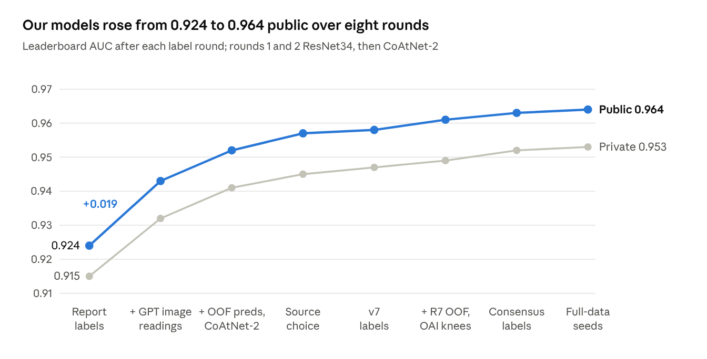

# 10th Place Solution (Team MEJAL): Label Distillation and CoAtNet-2

Oct 24, 2026 · team MEJAL

This is the detailed write-up of Max's half of the team's solution. The team's write-up on Kaggle, covering both halves: [10th place solution](https://www.kaggle.com/competitions/rsna-knee-abnormality-detection/writeups/10th-place-solution).

**Team: private 0.957 (10th), public 0.967 · The team blend we assembled: private 0.956, public 0.967 · Our four CoAtNet-2 seeds alone, before the fine-tune: private 0.953, public 0.964 · External data: 2,398 OAI knee MRIs; R7's public weights (heliosli's ConvNeXt model, built with fastMRI and SKM-TEA); GPT-6 Astra image readings**

## Thanks

Thanks to RSNA and Kaggle for the competition, to our four teammates in team MEJAL, and to everyone whose public work we built on (listed below).

## Context

- Competition context: [RSNA Knee Abnormality Detection](https://www.kaggle.com/competitions/rsna-knee-abnormality-detection)
- Data context: [competition data](https://www.kaggle.com/competitions/rsna-knee-abnormality-detection/data)

Team MEJAL finished 10th on the private leaderboard. In this part, "we", "our" and "us" mean Max and Claude (Anthropic's AI assistant), who built one half of the team's work together: the label distillation rounds and the final labels (which also draw on the teammates' labels and models), four CoAtNet-2 models with their all-window fine-tune, and the assembly and post-processing of one of the team's two final blends. Our four teammates built the multi-backbone half (their own labels and several model families, which carry half the weight of the team blend) and write it up separately. Below, "the teammates" means those four.

The team had two final picks. One was the blend we assembled (Kaggle submission 57456685): a rank ensemble of the teammates' models (0.5), our four CoAtNet-2 models (0.3) and R7 (0.2). R7 is a public ConvNeXt-small model by Kaggle user heliosli, named after its weights dataset. The blend scored 0.967 public and 0.956 private. The teammates' pick (submission 57490913) scored 0.967 and 0.957, which set the team's place.

## Overview of our approach

Most of our gain came from better training labels. Our models alone rose from 0.924 to 0.964 public in 11 days (Oct 6 to Oct 17), with no blend at test time. Their training labels, though, drew on predictions from R7 and the teammates too. After the switch to CoAtNet-2 in round 3, each step changed the labels or added data. Rounds 5 and 6 also changed the image cache, which on its own made no clear difference on fold 0 (our first cross-validation fold).

- **Labels in rounds.** We started from soft labels (values between 0 and 1) read out of the radiology reports. Round 1 averaged in two more report readers for five findings. It also filled findings a report does not mention half from our first models' predictions on studies they never trained on. Round 2 added GPT readings of the images. From round 3, earlier models' out-of-fold predictions (each study's prediction from the model that did not train on it) went into the label of every cross-validation study. That is our distillation, and it works only through the labels.
- **One model family.** A CoAtNet-2 at 384 px looks at 3-slice windows from up to five series of a study. An attention head pools all windows into 12 finding scores. The image preparation and the head adapt dreaddevelopment's public Raptor notebooks.
- **Final models.** Four copies of one recipe with different random seeds, each trained on all but 100 studies and fine-tuned at the end on every window. They join the teammates' models and R7 in a rank blend: teammates 0.5, ours 0.3, R7 0.2.
- **How we judged changes.** Out-of-fold scores on the 4,296 cross-validation studies, against three label sets (defined under Validation): severity-aware report labels, agreement labels and the teammates' labels. For label changes the leaderboard had the final word, because those label sets share sources with the training labels.

## Labels: distillation through the training labels

Our distillation works through the labels only. There is no extra loss term that copies an earlier model, no temperature setting and no earlier model running during training, and each round's models start again from ImageNet weights.

### The problem

The host gives 4,407 training studies, each with a free-text radiology report, but labels for only 58 of them. Those 58 expert studies were read by two radiologists, with a third settling disagreements. The test set (about 1,300 studies) has no reports. So the main job is good labels for the other 4,349 studies.

The score is the mean ROC AUC over 12 findings. These are ACL, MCL, both menisci, medial, lateral and patellofemoral (PF) OA, effusion, synovitis, Baker's cyst, contusion and fracture. Below, a cell is one finding of one study, and a cell is silent when the report does not mention that finding. For seven findings the host counts mild cases as absent: ACL, MCL, the three OA findings, effusion and Baker's cyst. These are the findings with a severity threshold.

### Label sources

| Source | What it is | How we used it |
| --- | --- | --- |
| [Raptor report labels](https://www.kaggle.com/datasets/dreaddevelopment/rsna-knee-labels) (dreaddevelopment, v3) | A large language model (LLM) reading of each report, graded 0.05 to 0.95 | Base of every round |
| [stevenleehans v2](https://www.kaggle.com/datasets/stevenleehans/rsna-knee-llm-report-labels) and [lixin73 GPT-5.6-Sol](https://www.kaggle.com/datasets/lixin73/rsna-knee-llm-report-labels-sol56) | Two more LLM readings of the reports | Averaged in for the five findings without a severity threshold |
| [Pilkwang v1](https://www.kaggle.com/datasets/pilkwang/rsna-knee-llm-labels) | Report readings with yes / no / unknown | Decides which cells a report mentions; builds two of our three validation label sets; scores the report on the expert studies |
| GPT-6 Astra image readings | Our own run of OpenAI's model on the images, no report | Mixed in from round 2 |
| Out-of-fold predictions | Our models; later also R7 and the teammates' models | Silent cells from round 1, every cell from round 3 |

### One round, step by step

1. Train fold models on the current labels.
2. Collect out-of-fold predictions: each study's prediction comes only from the fold model that did not train on it.
3. Put our own predictions back on the label scale with p / (p + w(1 − p)), where w is that finding's positive-class weight in the loss. The weight pushes predictions up, and this formula undoes it. In round 6, R7's predictions were instead matched by rank onto the values of our converted predictions. In round 7, all models' predictions, ours included, were blended by rank and matched onto the label values (source S3 of the final labels, below).
4. Mix the predictions with the other sources, per finding. The rule changed by round (see below).
5. Train the next round's models from ImageNet weights on the new labels.


*"Put back on the label scale" means mapped onto the range of the label values. In the last round, the teammates' labels (their image-and-report readings mixed with report-only readings) joined the mix as well.*

In most rounds, earlier models' out-of-fold predictions joined the report and image readings as a label source.

### Rules that mattered

- **Silent cells stay soft.** When a report does not mention a finding, the Raptor file usually gives a set soft value, such as ACL 0.20 or Baker's 0.05. On the few expert studies with such silence, these roughly match the expert rate (Baker's 1 in 29), but PF OA (3 in 14) and fracture (4 in 26) sit lower. In a fold-0 test on 0/1 report labels, we filled the silent cells of seven findings with hard zeros. That scored 0.0126 lower than leaving those cells out of the loss (Baker's −0.029, MCL −0.025).
- **Mild counts as absent.** For the seven findings with a severity threshold, the host counts only high-grade or moderate-to-large findings. The Raptor values already score mild mentions low (median 0.20), so we averaged in other readers only for the other five findings. On fold 0, averaging only those five (where the report states them) gained +0.0046; averaging all 12 scored 0.0028 lower, within noise.
- **GPT read the images, not the reports.** It saw every slice of every series: a median of 162 grayscale PNGs per study, at most 512 px. The prompt (`configs/llm/gpt_image_labels_v1.md` in this repository) carried the host's 12 definitions and said borderline cases count as negative. We ran it at medium reasoning effort. The model returned a 0–100 probability per finding in strict JSON, and we used the value divided by 100, with no calibration.
- **Source choice: the expert studies set the mix in rounds 4 and 5.** A source's weight was how often it had the best AUC on that finding across 2,000 resamples of 57 expert studies (one had no Pilkwang reading). Each weight stayed between 10% and 70%. Without that cap, the trained models scored 0.007 lower on the experts.
- **For label changes, the leaderboard was the check.** Scores on report-based labels misread label changes. GPT readings moved them by only +0.001 but the public leaderboard by +0.019. Source choice moved them by −0.005 and the public leaderboard by +0.005.

### The rounds



*Chart labels: "OOF preds" = out-of-fold predictions; "v7 labels" = our round-5 labels; "R7 OOF" = R7's out-of-fold predictions; "Consensus labels" = the final labels; "Full-data seeds" = the four final models, trained on all studies but 100.*

The biggest single step was the GPT image readings: +0.019 public and +0.017 private. That round also began choosing checkpoints on the agreement labels (see Validation), which use GPT too. What each round changed:

1. Five ResNet34 "student" models. Their "teachers" were five ResNet34 fold models trained on the Raptor labels. Silent cells = 0.5 × the teachers' out-of-fold predictions + 0.5 × Raptor; three report readers averaged for five findings.
2. GPT image readings mixed into every cell at one third.
3. Round-2 out-of-fold predictions mixed into every cell: 0.35 where the report states the finding and report, GPT and the round-1 teachers agree, else 0.65. First CoAtNet-2.
4. Source choice: labels rebuilt per finding from report, GPT and CoAtNet out-of-fold, weighted on the expert studies.
5. Our round-5 labels (v7 in our scripts): source choice again, but the model source is now CoAtNet fold models trained on report-plus-GPT labels only (v6 in our scripts).
6. Our round-6 labels (D in our scripts): 0.7 × the round-5 labels + 0.3 × R7's out-of-fold predictions; 2,398 OAI knees added.
7. The final labels (below; "consensus" in our file names); the 58 expert studies and the 53 studies whose reports name none of the 12 findings join training; 4 folds instead of 5.
8. The same labels, four seeds trained on all but 100 studies.

Rounds 1 and 2 are ResNet34 with mirrored predictions; rounds 3 to 8 are CoAtNet-2 without mirroring. Some rounds also changed the image cache.

### The final labels

For the 4,296 cross-validation studies and the 53 studies whose reports name no target finding, each cell is the mean of three sources:

- **S1:** our round-5 labels. For the 53, GPT's image readings stand in.
- **S2:** the teammates' labels: 0.7 × vision-language model (VLM) + 0.3 × language model (LLM) readings. They are public as `labels/rsna/conv_labels_used.csv` on the teammates' [`codex/our-pipeline`](https://github.com/Evan2001ok/rsna-knee-abnormality-detection/tree/codex/our-pipeline) branch.
- **S3:** all models' out-of-fold predictions blended by percentile rank per finding: the teammates' nine sets 0.45, our three CoAtNet sets 0.30, R7 0.25. We fitted these weights to our three validation label sets; they beat equal weights by only +0.0001 on held-out halves. The result takes the value scale of (S1 + S2) / 2.

The 58 expert studies keep the host's expert 0/1 labels, and the OAI knees keep their own labels (next section). One more round would have moved labels by only 0.0017 per cell, so we stopped.

One caveat: offline scores on these labels look better than they really are. The teammates' models and R7 were trained on other splits than ours (and the teammates' models also used the 58 expert labels in training), so some of their predictions had already seen our checking studies. Before any training, the labels already sat about 0.019 closer than the round-6 labels to two of our three validation label sets. So the leaderboard decided.

## Models and training

Our part of the final team blend is four CoAtNet-2 models with one recipe and seeds 42 to 45. Each trains on all but 100 studies, then gets a 4-epoch fine-tune on every window. Each starts from timm's `coatnet_rmlp_2_rw_384.sw_in12k_ft_in1k` ImageNet weights (73M parameters). The image preparation and the attention head adapt dreaddevelopment's public Raptor notebooks (Apache-2.0).

### Input

- **Series slots.** The host's series table gives each series' plane and a fluid-sensitive flag. Each study fills five slots: sagittal fluid-sensitive (32 slices), sagittal other (24), coronal fluid-sensitive (32), coronal other (24) and axial (32). A slot takes the first unused series of its plane with the wanted flag, else any unused series of that plane; an empty slot is skipped.
- **Slices.** Sorted by physical position, taken from the 6% to 94% depth span: every slice if they fit, otherwise evenly spaced.
- **Brightness.** Scaled per series to its 2nd to 98th percentile and stored as 8-bit; ImageNet mean and standard deviation inside the model.
- **Crop and size.** A square 140 mm centre crop (from the pixel spacing), cached at 336 px and enlarged to 384 px when loaded.
- **Window.** 3 neighbouring cached slices of one series as the 3 colour channels (in long series these are evenly spaced, not adjacent, source slices). A study has at most 134 windows (median 110).
- **Head.** LayerNorm, then Linear(1024, 256), Tanh, Dropout 0.2 and Linear(256, 12) give each window a score per finding. A softmax over all windows of the study pools the 1,024 features per finding, and a per-finding linear layer gives the 12 logits. All series go into one bag; the head gets no plane or position input.

### Training recipe

| Setting | Value |
| --- | --- |
| Loss | BCE with logits on soft labels; blank cells skipped; fixed positive weights: ACL 4.17, MCL 7.54, medial meniscus 1.34, lateral meniscus 3.65, medial OA 2.60, lateral OA 4.03, PF OA 1.78, effusion 2.06, synovitis 1.22, Baker's 4.83, contusion 3.08, fracture 7.69. These are the mean of our first five folds' weights, set from the Raptor labels by w = (1 − p)/p, with p the mean label clipped to 0.03–0.70 and w to 1–10 |
| Optimizer | AdamW; encoder 3e-5, head 1e-3; weight decay 0.02; gradient clip 3.0; bf16 |
| Schedule | PyTorch one-cycle, 15% warm-up, cosine decay |
| Batch and length | 8 studies per update (4 × 2 accumulated); 24 epochs |
| Windows per study | 12, shared across series by their window counts and drawn at random within each series |
| Augmentation | Mirror p 0.5 (coronal and axial flipped, sagittal slice order reversed, so all planes agree); affine p 0.8 (±15°, zoom 0.9–1.15, shift 8%); gamma and contrast p 0.8; bias field p 0.3; noise p 0.3; blur p 0.15; low resolution p 0.15; brightness ×0.9–1.1. The 3 slices of a window share one transform |
| Series hiding | Each series hidden with p 0.15; each plane keeps at least one |
| Checkpoint | Weights of epochs 22–24 averaged (fold runs: best 3 of epochs 17–24 on the agreement labels) |
| Speed | Compiled encoder and channels-last memory |

### Training data

- **Folds.** The 4,296 cross-validation studies in 4 folds, from multilabel-stratified K-fold (iterative-stratification, seed 42) on Pilkwang's yes/no report labels. We used no patient mapping, so folds split by study. Rounds 1 to 6 used 5 folds made the same way. The 58 expert studies (with the host's expert labels), the 53 studies whose reports name no target finding and the OAI knees are always in training.
- **Full-data seeds (our four final models).** 6,705 in training: 4,196 cross-validation studies, the 58 expert and 53 unlabeled studies, and 2,398 OAI knees. 100 cross-validation studies are held out, picked at random so each finding has at least 3 positives and 3 negatives. Base training only uses them to catch bugs, since epochs 22–24 are always averaged. The fine-tune uses them to pick its best 3 of 4 epochs.
- **OAI knees.** 2,398 baseline knees from 2,028 people in the [Osteoarthritis Initiative](https://nda.nih.gov/oai), through the NIMH Data Archive. Their SAG_IW_TSE, COR_IW_TSE and AX_MPR series fill 3 of the 5 slots, with the same image preparation. They are used for training only and added +0.001 on the public leaderboard twice.

OAI has no labels for the host's findings, so we mapped its MOAKS (MRI Osteoarthritis Knee Score) grades:

| Finding | MOAKS source | Label value |
| --- | --- | --- |
| ACL | ACL tear | complete 1, partial 0.5, none 0 (reconstructed: blank) |
| Medial and lateral meniscus | meniscal tear | any tear or root tear 1, signal only or normal 0 |
| Medial, lateral and PF OA | worst cartilage subregion of the compartment | full-thickness loss over ≥10% of the area 1; any full-thickness loss under 10% 0.7; partial-thickness loss only, ≥10% 0.35; partial-thickness loss only, under 10% 0.1; none 0 |
| Effusion | effusion-synovitis | moderate or severe 1, mild 0.1, none 0 |
| Synovitis | Hoffa synovitis | severe 1, moderate 0.7, mild 0.2, none 0 |
| Baker's cyst | popliteal cyst | present 0.6 (no size in MOAKS), absent 0 |
| MCL, contusion, fracture | none | blank |

For the menisci, the three OA findings, effusion and synovitis, the final OAI labels average this mapping 50/50 with the teammates' readings. In those, a vision-language model read each knee's images with its MOAKS grades. Where only our value exists, ours is kept.

### The all-window fine-tune

This was our last step. Each seed continues from its averaged weights for 4 more epochs, with every window of the study's kept series in each example. Series hiding stays on.

- **Settings:** one study per step, 8 steps per update; a new one-cycle with peaks of 1e-5 (encoder) and 3e-4 (head); BatchNorm statistics frozen; gradient checkpointing on, compile off. The best 3 of the 4 epochs on the 100 held-out studies are averaged.
- **Gain:** +0.0021 out of fold and +0.0006 inside the team blend, measured on the round-7 models (4 folds on the final labels), since the full-data seeds have no out-of-fold predictions. Every finding gained, contusion the most (+0.006). On the round-6 fold models, a 12-window control with the same 4 extra epochs gained nothing, so the extra windows, not the extra epochs, made the gain.
- **Leaderboard:** the team blend went from 0.966 / 0.955 to 0.967 / 0.956 (public / private); prediction windows were cut from 112 to 56 at the same time. A teammate's re-run of the same notebook code (submission 57423326) scored 0.966 / 0.956, so the public step is within rounding.

The simpler version, the four full-data seeds without the fine-tune, scores 0.964 public / 0.953 private on its own.

## Inference and the team blend

Our team notebook (submission 57456685) runs three groups of models one after another in one Kaggle notebook on 2× T4, each group as one stage, then blends them by rank: teammates 0.5, ours 0.3, R7 0.2. It scored 0.967 public / 0.956 private. The score came back about 7 h after we submitted it.

| Group | Models | Weight | At test time |
| --- | --- | --- | --- |
| Teammates | Four of the teammates' model sets, equal mean of their probabilities | 0.5 | Their own process |
| Ours | 4 CoAtNet-2 seeds, all-window fine-tuned, equal mean | 0.3 | 56 windows per study, evenly spaced over all its windows in slot order (short studies repeat some); fp16, two models per T4, no flips |
| R7 | heliosli's public ConvNeXt-small ([weights](https://www.kaggle.com/datasets/heliosli/rsna-knee-compact-r7cnxfsss)), 4 folds | 0.2 | Setup and run cells from [its public notebook](https://www.kaggle.com/code/heliosli/0-957-latest-dataset-score-in-one-click), without the Raptor model stage that notebook also runs |

### Noisy-OR on ranks, plus sibling corrections

1. **Ranks.** Per finding, each group's predictions become percentile ranks r among the m studies that group scored.
2. **Noisy-OR.** Each rank becomes −log(1 − r + 0.5/m), then a weighted mean over groups. The value stays small for most studies and grows fast near the top, so a study that any one group ranks near the top rises, like an independent "present" vote.
3. **Normal scores.** The blended column is ranked again and turned into normal scores (inverse normal of r − 0.5/n).
4. **Sibling corrections.** On those scores: Lateral OA − 0.10 × Medial OA, PF OA − 0.10 × Medial OA, Synovitis − 0.20 × Effusion. Part of each weaker score is a general "arthritic knee" or "fluid" signal that it shares with its partner finding, and this subtraction removes some of it. The same subtraction with clinically unrelated partner findings gave no gain.
5. **Output.** The percentile rank of the result. If a group failed on a study, that study takes the other groups' score.

Out of fold, steps 2 to 4 gained about +0.0004 over our earlier rank blend, with the subtraction sizes chosen on one half of the studies and scored on the other. The gain was positive in all 10 halves of 5 random 50/50 splits (a replay of the finished notebook code with those sizes gave +0.0005). Both leaderboard scores stayed level (public 0.966, private 0.955), but on the public leaderboard the team moved from 9th to 8th.

### How the weights were chosen

We fixed 0.5 / 0.3 / 0.2 on Oct 15, before an out-of-fold test on the models of that day. There it beat the teammates' sets alone on all three label sets (+0.0060, +0.0013, +0.0013). It was also the best point of a small grid, which flatters it slightly. Refitted weights gained only on the severity-aware labels, which favour our models. A version with the teammates at 0.30, ours at 0.45 and R7 at 0.25 (submission 57436336) scored the same 0.967 / 0.956.

### Staying under 9 hours

- **Hard stops per stage:** 3.5 h for the teammates' stage (from its own start), 5.75 h for ours and 8.5 h for R7 on the notebook clock. Our stage gives any study it did not finish the mean prediction and flags it; the blend then uses the other groups' score for that study. Three earlier runs of the team notebook (two submitted by us, one by a teammate) had run past 9 hours. Kaggle kept no logs, but at that time only the teammates' stage had a time limit, so the likely cause was a call in our stage or R7's that never returned.
- **56 windows instead of 112:** our stage drops from an estimated 1.34 h to 0.93 h, with about no change in the team blend.
- **JPEG Lossless decoders:** installed from offline wheels before the first stage. Without them, series stored as JPEG Lossless could not be read in the first stage (4 of 4 such series in a local test).

## Validation, and what worked

Out-of-fold scores were good for model and blend changes but misread label changes, so for labels the public leaderboard decided.

### How we validated

- **Out of fold on 4,296 studies, against three label sets.** Severity-aware report labels (Pilkwang's readings; mild counts as absent, as the host defines it). Agreement labels (a report's 0/1 kept only where GPT's image reading agrees; silent cells filled when GPT is at least 0.9 or at most 0.1). And the teammates' labels, which tracked the leaderboard best.
- **The expert studies as an outside check.** They stayed clean until Oct 10, when the labels started using them to set weights.
- **The leaderboard, read with care.** The public part is about 390 studies at 3 decimals, so a 0.001 step proves little. From Oct 13 we wrote down before each score what it would mean. On Oct 12 we also made three single-finding submissions to read the public AUC of PF OA, lateral OA and synovitis.
- **Where out of fold failed.** On the severity-aware labels, round 3 scored 0.914 and round 5 only 0.903. Over the same rounds the public score rose from 0.952 to 0.958. Distillation also flatters out-of-fold scores: a fold's training labels hold predictions from earlier models that trained on its validation studies. Public minus private stayed 0.009–0.012 in every round, and the order held.

### What helped beyond the label rounds

| Change | Result |
| --- | --- |
| Every-slice image cache, early ResNet34 test | +0.0154 out of fold |
| Stronger augmentation over 24 epochs, same test | +0.0140; both together +0.0206 |
| R7 at 30% in a rank blend with our models | +0.003 to +0.004 on the public leaderboard |

One more lesson from the start: we first submitted the best fully public stack ([Jiwei Liu's notebook](https://www.kaggle.com/code/jiweiliu/rsna-knee-fast-2xt4-inference?scriptVersionId=352245350) V11, running the Speedy Raptors models). We added a public ACL model (KAMRNet) at 20% or 50%. Both scored 0.943 public but 0.927 private. Our own first 0.943 model scored 0.932 private. Partners help only when they are strong and different: the public Raptor CoAtNet, the same family as ours, added nothing.

### What did not work

| Tried | Result | Lesson |
| --- | --- | --- |
| Judging label changes on report-based labels | GPT labels: +0.001 there, +0.019 on the public leaderboard. Source choice: −0.005 there, +0.005 on the public leaderboard | Judge label changes on the expert studies and the leaderboard |
| Hard zeros for findings the report does not mention | −0.0126 on fold 0 (ResNet34), against leaving those cells out of training | Do not fill silent cells with hard zeros |
| Blanking cells where the report and GPT disagree | −0.010 on the expert studies | Borderline cells still carry signal |
| Uncapped per-finding source weights | −0.007 on the expert studies | Keep each source between 10% and 70% |
| Averaging our own weaker models (a DINOv3-B and our ResNet34s, not the teammates' models) into our CoAtNet | Public leaderboard 0.945 against 0.952 for our CoAtNet alone | Add only partners that are strong and different |
| Other AI image readers, scored on 57 expert studies | GPT-6 Astra (medium effort) 0.926, at high effort 0.920; Gemini 4 Argon 0.822; Claude Opus 5.5 0.760; Claude Fable 5.1 0.733 | Test readers on the expert studies before running them on all studies |
| 24 training windows instead of 12, from scratch (ResNet34, fold 0) | −0.0008 to −0.0057 on four label sets (experts −0.013); most intervals include zero | Use all windows only in a short fine-tune at the end |
| Fine-tuning 8 or 2 epochs instead of 4 | Both 0.966 public, 0.956 private | Length barely matters |
| Per-finding or refitted blend weights | 0.966 / 0.956 and 0.967 / 0.956 | Neither beat the fixed 0.5 / 0.3 / 0.2 |
| Public specialist models (KAMRNet ACL and others) | KAMRNet ACL at 20% and 50%: public leaderboard unchanged at 0.943 | Strong on 58 studies is not enough |
| OAI follow-up visits | +0.0002 and +0.00003 | Baseline knees were enough |
| Extra test-time views (rotations, flips) | Team blend: 3 rotations on top of 56 windows −0.00002; mirrored R7 +0.0002 on one of three label sets, for about 2 h more; 3 rotations with windows cut to 19 −0.00025 | Use the time for more windows instead |
| Image size and crop changes | 448 px no gain; 320 px level once, −0.0013 in a re-test; 224 px (ResNet34) −0.009 to −0.013 | 384 px with a 140 mm crop worked best of what we tried |
| Calibration-only post-processing, stacking | No gain | AUC needs a change of order, not of scale |

## External data, public work and tools

Our half trained on one outside image dataset (OAI). Through R7, our team blend and labels also use models trained with fastMRI and SKM-TEA images. For labels we used one AI service, GPT-6 Astra image readings. We also tried three other AI image readers, from Anthropic and Google. Our labels also include the teammates' AI readings. We also used several public Kaggle datasets and notebooks. The table lists each one, with shared weights next to their source datasets.

| Item | Where we used it | Access |
| --- | --- | --- |
| [Osteoarthritis Initiative](https://nda.nih.gov/oai) (OAI): 2,398 baseline knees with MOAKS grades | Training only, from round 6 | Free. Sign in to the NIMH Data Archive and accept the OAI data-use terms. |
| GPT-6 Astra through the OpenAI API | Image readings of the 4,349 non-expert training studies, used in labels, and of the 58 expert studies, to score readers and set source weights. Images only (8-bit PNGs up to 512 px), never reports, sent with the API's store option off | Public API; needs an OpenAI account |
| Public report labels: [Raptor](https://www.kaggle.com/datasets/dreaddevelopment/rsna-knee-labels), [stevenleehans v2](https://www.kaggle.com/datasets/stevenleehans/rsna-knee-llm-report-labels), [lixin73 GPT-5.6-Sol](https://www.kaggle.com/datasets/lixin73/rsna-knee-llm-report-labels-sol56), [Pilkwang v1](https://www.kaggle.com/datasets/pilkwang/rsna-knee-llm-labels) | Label making and validation labels | Free, CC0 Kaggle datasets |
| R7: heliosli's public ConvNeXt-small [weights](https://www.kaggle.com/datasets/heliosli/rsna-knee-compact-r7cnxfsss), its [code and knee-finder dataset](https://www.kaggle.com/datasets/heliosli/rsna-orthofoundation-fold0-epoch7-20261004) and the setup and run cells of [its public notebook](https://www.kaggle.com/code/heliosli/0-957-latest-dataset-score-in-one-click). It starts from ImageNet-22k weights and trained on the competition data with report-based labels. Its outside sources: [NYU fastMRI](https://fastmri.med.nyu.edu/) images with [fastMRI+](https://github.com/microsoft/fastmri-plus) boxes as a training side task, and a knee finder trained on [SKM-TEA](https://aimi.stanford.edu/datasets/skm-tea-knee-mri) | 0.2 of the final blend; its out-of-fold predictions in our labels (rounds 6 to 8). We ran its published fold models; we did not retrain it | Free public notebook and datasets. Both datasets are marked licence "Other" on Kaggle, and neither description grants a licence. Its upstream data (fastMRI, SKM-TEA) need sign-up and a research-use agreement; we did not download them |
| timm `coatnet_rmlp_2_rw_384.sw_in12k_ft_in1k` (ImageNet-12k, then ImageNet-1k; Apache-2.0, from the Hugging Face Hub); torchvision ResNet34 (rounds 1 and 2) | Starting weights | Free |
| dreaddevelopment's public Raptor [training notebook](https://www.kaggle.com/code/dreaddevelopment/knee-mri-training-the-twelve-finding-model?scriptVersionId=347608187) (V8) and [inference notebook](https://www.kaggle.com/code/dreaddevelopment/knee-mri-twelve-findings-from-a-single-model?scriptVersionId=344173275) (V1) | Image preparation and attention head, adapted | Free, Apache-2.0 |
| Python packages shipped as offline wheels in our Kaggle bundle (the dataset that holds our weights, code and install files), including the JPEG decoders pylibjpeg, pylibjpeg-openjpeg and pyjpegls (MIT) and pylibjpeg-libjpeg (GPL-3.0) | Inference | Free, open source |
| The teammates' labels and models | Our labels (S2, S3 and half of the OAI labels) and 0.5 of the blend. So any outside data, weights or AI services behind those labels and models also reach our four models | See the teammates' write-up and their branch |

We also sent the 58 expert studies' images to Gemini 4 Argon, Claude Opus 5.5 and Claude Fable 5.1, scoring them on 57. None of these trial readings went into our labels.

OAI acknowledgement: Data and/or research tools used in the preparation of this manuscript were obtained and analyzed from the controlled access datasets distributed from the Osteoarthritis Initiative (OAI), a data repository housed within the NIMH Data Archive (NDA). OAI is a collaborative informatics system created by the National Institute of Mental Health and the National Institute of Arthritis, Musculoskeletal and Skin Diseases (NIAMS) to provide a worldwide resource to quicken the pace of biomarker identification, scientific investigation and OA drug development. Dataset identifier(s): NDA Study 3429, DOI 10.15154/wfxg-g926.

## Code, weights and sources

- **Training and inference code:** [this branch](https://github.com/Evan2001ok/rsna-knee-abnormality-detection/tree/coatnet-pipeline), under CC BY-NC 4.0; parts adapted from the Raptor notebooks keep their Apache-2.0 licence
- **Weights:** [a public Kaggle dataset](https://www.kaggle.com/datasets/max6296/knee-coatnet-consensus-all-ftall-w56-bundle) of the four fine-tuned seeds, with the inference code the team blend submission used
- **Inference notebook:** a public version of the final team notebook (submission 57456685), to be added

The final configs read a training folder that is not in git. It holds the final labels, the 2,398 OAI knees, the 58 expert studies and the splits. To rebuild it:

- Image cache: `scripts/prepare_raptor.py --variant raptor-dense-distinct-v1`.
- GPT readings: `scripts/gpt_image_labels.py` (needs an OpenAI account).
- Labels, in round order: `prepare_raptor_labels.py`, `prepare_averaged_labels.py`, `prepare_student_labels.py`, `prepare_gpt_mixed_labels.py`, `prepare_round3_labels.py`, `prepare_source_choice_labels.py`, `prepare_packed_labels.py`, `prepare_consensus_labels.py`. Most steps need earlier models' out-of-fold predictions.
- OAI: the scripts in `scripts/oai/`. Each user must get the images from the NIMH Data Archive.
- Folder and the 100 held-out studies: `scripts/make_consensus_combined.py`, then `scripts/make_all_studies_split.py`.

S2, the teammates' labels, is public on their branch (see The final labels). S3 also needs the teammates' and R7's out-of-fold predictions, and half of the OAI labels need the teammates' OAI readings; those are not public. The team notebook is built by `scripts/build_team_combined_notebook.py`. The README on this branch gives every step in more detail.

Then, to train our four models and export them:

```
uv sync --locked
uv run knee train --config configs/final/coatnet_384_consensus58_all_s42.yaml
uv run knee train --config configs/final/coatnet_384_consensus58_all_ftall_s42.yaml
uv run knee export --checkpoints runs/coatnet_384_consensus58_all_ftall_s4{2,3,4,5}/averaged-model.pt --output-dir bundle --wheelhouse <offline wheels> --eval-windows 56
# The submitted bundle was built with older export code that does not drop unreadable series; the current code does.
```

The two training commands run once per seed (42 to 45).

### Sources

- Competition: [RSNA Knee Abnormality Detection](https://www.kaggle.com/competitions/rsna-knee-abnormality-detection)
- Dai et al., 2021. [CoAtNet: Marrying Convolution and Attention for All Data Sizes](https://arxiv.org/abs/2106.04803)
- Ilse et al., 2018. [Attention-based Deep Multiple Instance Learning](https://arxiv.org/abs/1802.04712)
- [timm (PyTorch Image Models)](https://github.com/huggingface/pytorch-image-models)
